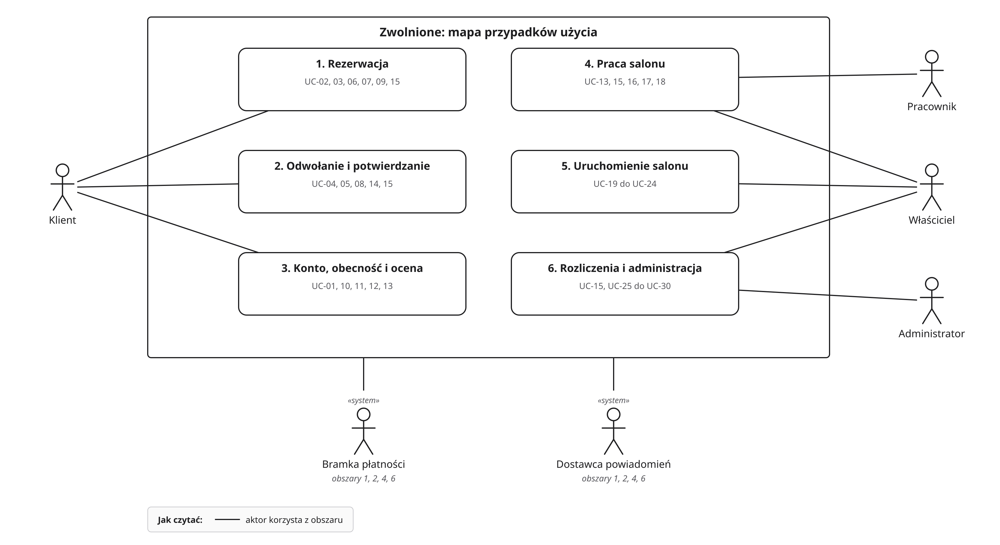
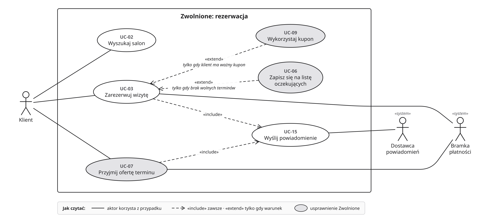
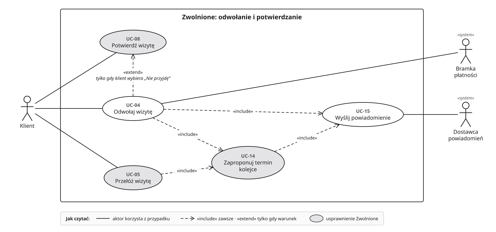
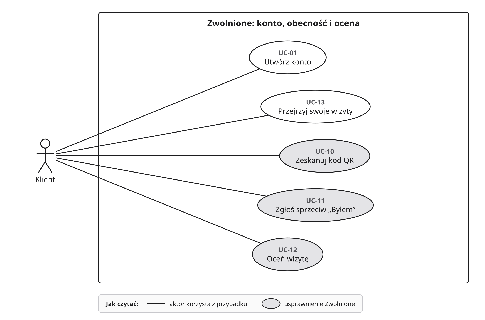
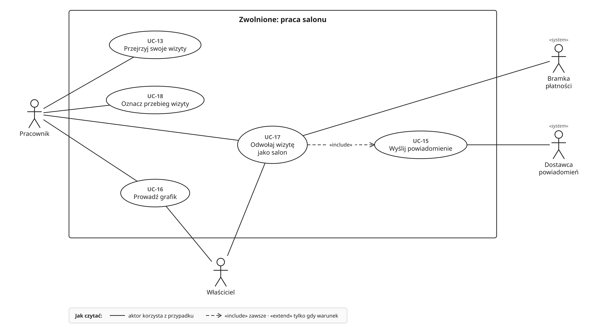
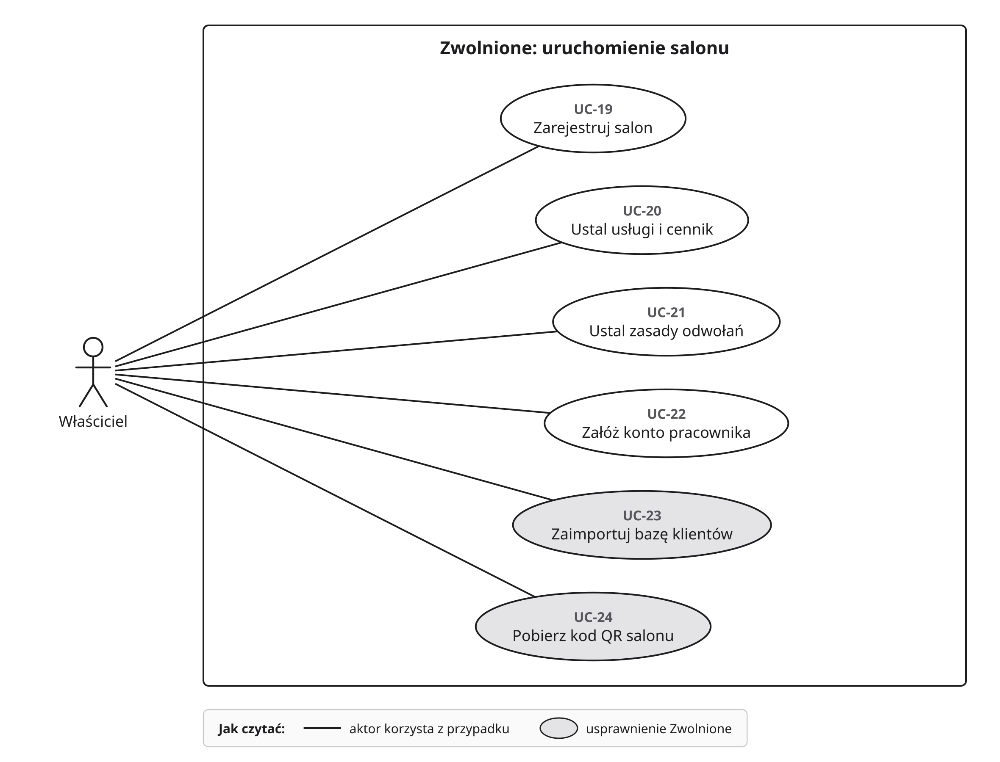
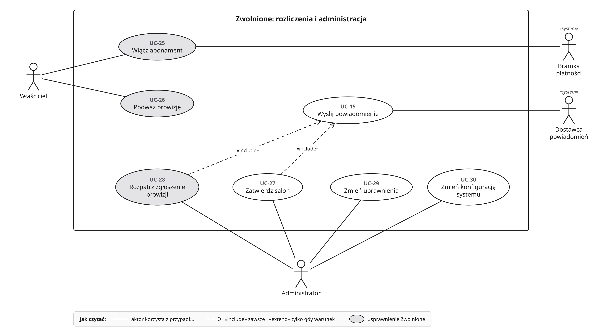
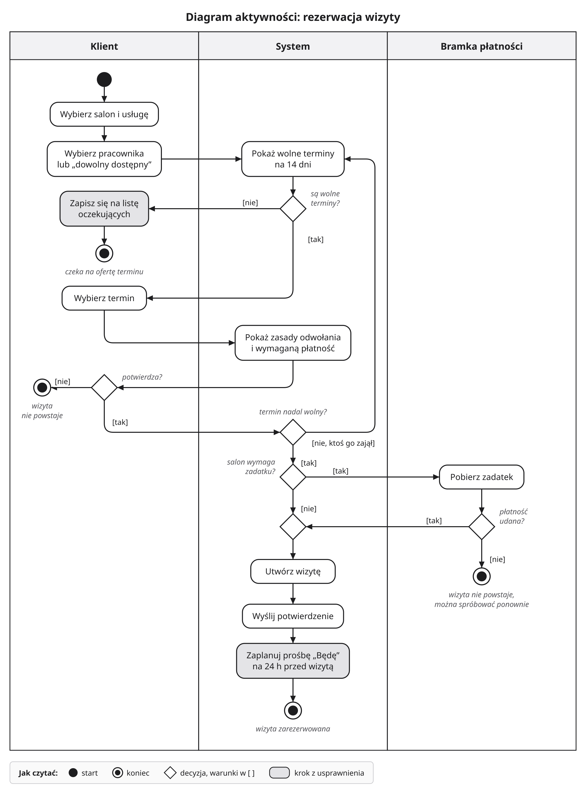
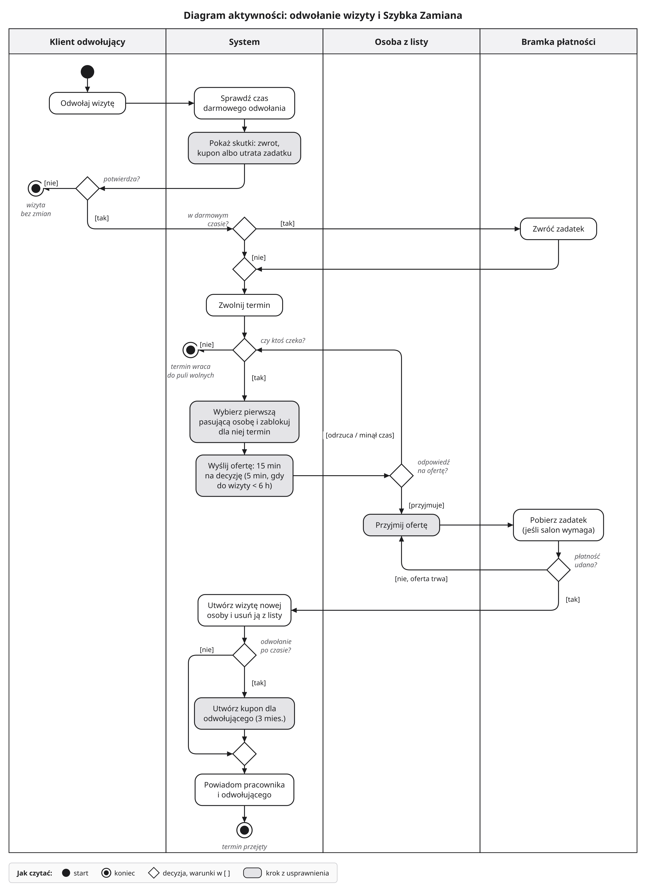

# Rozdział 3. Przypadki użycia i diagram aktywności

> Stan na 19.11.2026. Rozdział opisuje zachowanie aplikacji Zwolnione z rozdziału 2: kto z niej korzysta, co może w niej zrobić i jak przebiegają dwa najważniejsze procesy. Przypadki użycia wynikają z wymagań WF-01 do WF-30.

## Spis treści

- [3.1. Diagram przypadków użycia](#31-diagram-przypadków-użycia)
  - [Aktorzy](#aktorzy)
  - [Jak czytać diagramy](#jak-czytać-diagramy)
  - [Lista przypadków użycia](#lista-przypadków-użycia)
  - [Mapa całości](#mapa-całości)
  - [Diagram 1. Rezerwacja](#diagram-1-rezerwacja)
  - [Diagram 2. Odwołanie i potwierdzanie](#diagram-2-odwołanie-i-potwierdzanie)
  - [Diagram 3. Konto, obecność i ocena](#diagram-3-konto-obecność-i-ocena)
  - [Diagram 4. Praca salonu](#diagram-4-praca-salonu)
  - [Diagram 5. Uruchomienie salonu](#diagram-5-uruchomienie-salonu)
  - [Diagram 6. Rozliczenia i administracja](#diagram-6-rozliczenia-i-administracja)
  - [Główne scenariusze](#główne-scenariusze)
  - [Decyzje modelowe](#decyzje-modelowe)
- [3.2. Diagram aktywności](#32-diagram-aktywności)
  - [Diagram 3.2a. Rezerwacja wizyty](#diagram-32a-rezerwacja-wizyty)
  - [Diagram 3.2b. Odwołanie wizyty i Szybka Zamiana](#diagram-32b-odwołanie-wizyty-i-szybka-zamiana)
- [Jak usprawnienia widać w tym rozdziale](#jak-usprawnienia-widać-w-tym-rozdziale)

---

## 3.1. Diagram przypadków użycia

### Aktorzy

| Aktor | Grupa | Zakres odpowiedzialności | Przypadki użycia |
|---|---|---|---|
| **Klient** | klient | zakłada konto, szuka salonu, rezerwuje, odwołuje i przekłada wizyty, zapisuje się na listę oczekujących, przyjmuje oferty terminów, potwierdza obecność i ocenia wizyty | UC-01 do UC-13 |
| **Pracownik** | usługodawca | widzi swoje wizyty i grafik, oznacza przebieg wizyty, w razie potrzeby odwołuje wizytę | UC-13, UC-16, UC-17, UC-18 |
| **Właściciel** | usługodawca | rejestruje salon, ustala usługi, ceny i zasady odwołań, zakłada konta pracowników, importuje bazę klientów, płaci abonament i może podważyć prowizję | UC-16, UC-17, UC-19 do UC-26 |
| **Administrator** | moderacja | zatwierdza salony, rozpatruje zgłoszenia prowizji, zarządza uprawnieniami i konfiguracją systemu | UC-27 do UC-30 |
| **Bramka płatności** | system zewnętrzny | pobiera zadatki i abonament, zwraca pieniądze | UC-03, UC-04, UC-07, UC-17, UC-25 |
| **Dostawca powiadomień** | system zewnętrzny | dostarcza SMS i powiadomienia push | UC-15 |

Pracownik i Właściciel nie dziedziczą po sobie. Przypadki, które wykonują obaj (UC-16 i UC-17), mają po prostu dwie linie, po jednej do każdego aktora.

### Jak czytać diagramy

- **Linia ciągła** łączy aktora z przypadkiem, w którym bierze udział.
- **«include»** oznacza krok, który przypadek wykonuje zawsze. Przykład: odwołanie wizyty zawsze wysyła powiadomienie.
- **«extend»** oznacza krok dodatkowy, który zachodzi tylko przy spełnionym warunku. Warunek jest zapisany przy strzałce słowami „tylko gdy…”.
- **Szare tło** mają przypadki, które wynikają z naszych usprawnień: Szybkiej Zamiany, Prowizji z limitem i dowodem oraz Potwierdzonej obecności. Białe przypadki to podstawa, którą ma każda aplikacja rezerwacyjna.

Przypadków jest 30, więc dzielimy je na sześć diagramów tematycznych i mapę całości. Na jednym diagramie jest najwyżej 7 przypadków, a linie się nie przecinają. Diagramy rysuje skrypt w Pythonie z katalogu `docs/diagramy`, opisany w `docs/diagramy/NOTATKI.md`.

### Lista przypadków użycia

| ID | Przypadek | Wymaganie | Aktor | Diagram |
|---|---|---|---|---|
| UC-01 | Utwórz konto | WF-30 | Klient | 3 |
| UC-02 | Wyszukaj salon | WF-12 | Klient | 1 |
| UC-03 | Zarezerwuj wizytę | WF-01 | Klient, Bramka | 1 |
| UC-04 | Odwołaj wizytę | WF-02 | Klient, Bramka | 2 |
| UC-05 | Przełóż wizytę | WF-15 | Klient | 2 |
| UC-06 | Zapisz się na listę oczekujących | WF-03 | Klient, przez «extend» z UC-03 | 1 |
| UC-07 | Przyjmij ofertę terminu | WF-05 | Klient, Bramka | 1 |
| UC-08 | Potwierdź wizytę | WF-06, WF-24 | Klient | 2 |
| UC-09 | Wykorzystaj kupon | WF-08 | Klient, przez «extend» z UC-03 | 1 |
| UC-10 | Zeskanuj kod QR | WF-25 | Klient | 3 |
| UC-11 | Zgłoś sprzeciw „Byłem” | WF-26 | Klient | 3 |
| UC-12 | Oceń wizytę | WF-29 | Klient | 3 |
| UC-13 | Przejrzyj swoje wizyty | WF-22 | Klient, Pracownik | 3, 4 |
| UC-14 | Zaproponuj termin kolejce | WF-04 | część wspólna UC-04 i UC-05 | 2 |
| UC-15 | Wyślij powiadomienie | wiele | Dostawca powiadomień | 1, 2, 4, 6 |
| UC-16 | Prowadź grafik | WF-10 | Pracownik, Właściciel | 4 |
| UC-17 | Odwołaj wizytę jako salon | WF-14 | Pracownik, Właściciel, Bramka | 4 |
| UC-18 | Oznacz przebieg wizyty | WF-11 | Pracownik | 4 |
| UC-19 | Zarejestruj salon | WF-21 | Właściciel | 5 |
| UC-20 | Ustal usługi i cennik | WF-09 | Właściciel | 5 |
| UC-21 | Ustal zasady odwołań | WF-17 | Właściciel | 5 |
| UC-22 | Załóż konto pracownika | WF-18 | Właściciel | 5 |
| UC-23 | Zaimportuj bazę klientów | WF-19 | Właściciel | 5 |
| UC-24 | Pobierz kod QR salonu | WF-28 | Właściciel | 5 |
| UC-25 | Włącz abonament | WF-13 | Właściciel, Bramka | 6 |
| UC-26 | Podważ prowizję | WF-16 | Właściciel | 6 |
| UC-27 | Zatwierdź salon | WF-20 | Administrator | 6 |
| UC-28 | Rozpatrz zgłoszenie prowizji | WF-16 | Administrator | 6 |
| UC-29 | Zmień uprawnienia | WF-23 | Administrator | 6 |
| UC-30 | Zmień konfigurację systemu | WF-23 | Administrator | 6 |

**Relacje «include»:**
- UC-04 i UC-05 zawsze uruchamiają UC-14, bo zwolniony termin trafia do kolejki.
- UC-03, UC-04, UC-07, UC-14, UC-17, UC-27 i UC-28 zawsze uruchamiają UC-15, bo kończą się powiadomieniem.

**Relacje «extend»:**
- UC-06 rozszerza UC-03 tylko wtedy, gdy nie ma wolnych terminów.
- UC-09 rozszerza UC-03 tylko wtedy, gdy klient ma ważny kupon w tym salonie.
- UC-04 rozszerza UC-08 tylko wtedy, gdy klient zamiast „Będę” wybiera „Nie przyjdę”.

### Mapa całości

Mapa pokazuje cały system naraz: czterech aktorów-ludzi, dwa systemy zewnętrzne i sześć obszarów, z których każdy ma własny diagram. Klient korzysta z obszarów 1–3, a salon z obszarów 4–6. Administrator pracuje tylko w obszarze 6. Bramka płatności i Dostawca powiadomień obsługują obszary 1, 2, 4 i 6. Na mapie łączą się z ramką systemu, a dokładne połączenia widać na diagramach obszarów.

### Diagram 1. Rezerwacja

Klient wyszukuje salon (UC-02) i rezerwuje wizytę (UC-03). Jeśli nie ma wolnego terminu, może zapisać się na listę oczekujących (UC-06). Jeśli ma ważny kupon, odlicza go od ceny (UC-09). Gdy ktoś odwoła wizytę, osoba z listy dostaje ofertę i może ją przyjąć (UC-07). Rezerwacja i przyjęcie oferty pobierają zadatek przez Bramkę płatności i kończą się powiadomieniem (UC-15).

### Diagram 2. Odwołanie i potwierdzanie

Dzień przed wizytą klient potwierdza, że przyjdzie (UC-08). Jeśli wybierze „Nie przyjdę”, system przechodzi do odwołania (UC-04). Odwołanie zwraca zadatek przez Bramkę płatności, jeśli klient zdążył w darmowym czasie. Zarówno odwołanie, jak i przełożenie wizyty (UC-05) zwalniają termin, więc zawsze uruchamiają propozycję dla kolejki (UC-14). Ta z kolei wysyła ofertę przez UC-15.

### Diagram 3. Konto, obecność i ocena

Klient zakłada konto (UC-01) i przegląda swoje wizyty (UC-13). Pozostałe trzy przypadki należą do Potwierdzonej obecności. W salonie klient skanuje kod QR (UC-10), a jeśli salon niesłusznie oznaczy go jako nieobecnego, zgłasza sprzeciw „Byłem” (UC-11). Po wizycie może ją ocenić (UC-12).

### Diagram 4. Praca salonu

Pracownik przegląda swoje wizyty (UC-13) i po wizycie oznacza, czy się odbyła (UC-18). Grafik (UC-16) i odwołanie wizyty przez salon (UC-17) mogą wykonać zarówno Pracownik, jak i Właściciel. Przy odwołaniu przez salon klient wybiera zwrot pieniędzy przez Bramkę płatności albo nowy termin, a system zawsze wysyła mu powiadomienie. Takie odwołanie nie uruchamia kolejki, bo WF-14 tego nie przewiduje: salon odwołuje zwykle wtedy, gdy nie może wykonać usługi w tym terminie.

### Diagram 5. Uruchomienie salonu

Właściciel rejestruje salon (UC-19), ustala usługi i ceny (UC-20), zasady odwołań i wysokość zadatku (UC-21) oraz zakłada konta pracownikom (UC-22). Dwa przypadki wynikają z usprawnień. Import bazy klientów (UC-23) sprawia, że za stałych klientów salon nie płaci prowizji. Kod QR salonu (UC-24) jest potrzebny do potwierdzania obecności.

### Diagram 6. Rozliczenia i administracja

Właściciel włącza abonament, który pobiera Bramka płatności (UC-25). Jeśli nie zgadza się z naliczoną prowizją, podważa ją (UC-26), a Administrator rozpatruje zgłoszenie (UC-28). Administrator zatwierdza też nowe salony (UC-27), zmienia uprawnienia kont (UC-29) i konfigurację systemu, np. stawki (UC-30). Zatwierdzenie salonu i decyzja w sprawie prowizji zawsze kończą się powiadomieniem.

### Główne scenariusze

Pełne scenariusze z przebiegami alternatywnymi są w rozdziale 2. Poniżej najważniejsze w skrócie.

**UC-03 Zarezerwuj wizytę (WF-01).** Klient wybiera salon, usługę i pracownika. System pokazuje wolne terminy na 14 dni. Klient wybiera termin, widzi zasady odwołania i wpłaca zadatek, jeśli salon go wymaga. System tworzy wizytę i wysyła potwierdzenie. Gdy wolnych terminów brak, klient może zapisać się na listę oczekujących (UC-06). Przebieg pokazuje diagram aktywności 3.2a.

**UC-04 Odwołaj wizytę (WF-02).** Klient wybiera wizytę i „Odwołaj”. System pokazuje, czy klient dostanie zwrot, kupon, czy straci zadatek. Po potwierdzeniu system zwalnia termin i proponuje go kolejce (UC-14). Przebieg pokazuje diagram aktywności 3.2b.

**UC-07 Przyjmij ofertę terminu (WF-05).** Osoba z listy dostaje ofertę z czasem na decyzję. Klika „Przyjmuję” i wpłaca zadatek. System tworzy wizytę, a odwołujący dostaje kupon, jeśli odwołał po czasie. Gdy oferta wygaśnie, idzie do następnej osoby.

**UC-08 Potwierdź wizytę (WF-06, WF-24).** Na 24 h przed wizytą system prosi o potwierdzenie „Będę”, a 2 h przed pyta jeszcze raz. Kliknięcie „Nie przyjdę” prowadzi do odwołania. Wizyta bez zadatku i bez potwierdzenia trafia do kolejki, ale klient traci ją dopiero wtedy, gdy ktoś przyjmie ofertę.

**UC-10 Zeskanuj kod QR (WF-25).** W salonie klient skanuje kod QR. System sprawdza kod, czas i odległość od salonu, a potem zapisuje obecność. Dzięki temu salon nie może oznaczyć klienta jako nieobecnego, żeby uniknąć prowizji.

**UC-26 i UC-28 Podważ prowizję i rozpatrz zgłoszenie (WF-16).** Właściciel widzi przy każdej prowizji dowód, za co ją naliczono. Jeśli klient był już wcześniej w salonie, właściciel zgłasza prowizję i wskazuje tę wizytę, najpóźniej 30 dni od naliczenia. Administrator sprawdza zgłoszenie. Gdy je uzna, system cofa prowizję, a gdy odrzuci, właściciel widzi powód.

### Decyzje modelowe

- Aktorów jest sześciu, tak jak w rozdziale 2. CEIDG i KRS nie są aktorami, bo dane salonu sprawdza Administrator (WF-20).
- WF-07 (utworzenie kuponu) i WF-27 (licznik nieobecności) to kroki, które system wykonuje sam, bez udziału aktora. Nie są więc przypadkami użycia. Kupon widać na diagramie aktywności 3.2b.
- WF-06 i WF-24 to jeden przypadek „Potwierdź wizytę”, bo w obu klient odpowiada na to samo pytanie. WF-16 i WF-23 dzielimy na dwa przypadki, bo wykonują je różni aktorzy albo dotyczą różnych rzeczy.
- Bramka płatności łączy się bezpośrednio z przypadkami, które pobierają albo zwracają pieniądze.
- Logowania nie modelujemy. To krok techniczny, który poprzedza prawie każdy przypadek i niczego nie wnosi do diagramu.

---

## 3.2. Diagram aktywności

Pokazujemy dwa procesy. Zadanie zaleca rezerwację wizyty (3.2a). Nasze główne usprawnienie, Szybka Zamiana, działa jednak przy odwołaniu, dlatego dodajemy drugi diagram (3.2b). Oba mają tory dla uczestników, warunki przy każdej decyzji oraz przebiegi, które nie kończą się powodzeniem.

### Diagram 3.2a. Rezerwacja wizyty

**Tory:** Klient, System, Bramka płatności.

Klient wybiera salon, usługę i pracownika, a System pokazuje wolne terminy na 14 dni. Jeśli ich nie ma, klient może zapisać się na listę oczekujących i proces kończy się oczekiwaniem na ofertę. Gdy termin jest, klient go wybiera i widzi zasady odwołania oraz wymaganą płatność. Zanim system utworzy wizytę, sprawdza jeszcze raz, czy nikt nie zajął terminu w międzyczasie. Jeśli salon wymaga zadatku, pobiera go Bramka płatności. Na końcu System tworzy wizytę, wysyła potwierdzenie i planuje prośbę „Będę” na 24 h przed wizytą.

| Decyzja | Warunki | Co dalej |
|---|---|---|
| są wolne terminy? | [tak] / [nie] | wybór terminu / zapis na listę oczekujących |
| potwierdza? | [tak] / [nie] | dalsza rezerwacja / koniec, wizyta nie powstaje |
| termin nadal wolny? | [tak] / [nie, ktoś go zajął] | płatność / powrót do odświeżonej listy terminów |
| salon wymaga zadatku? | [tak] / [nie] | pobranie zadatku / od razu utworzenie wizyty |
| płatność udana? | [tak] / [nie] | utworzenie wizyty / koniec, można spróbować ponownie |

**Przebiegi bez powodzenia:** klient rezygnuje, termin zajmuje ktoś inny, płatność się nie udaje. W żadnym z nich wizyta nie powstaje.

### Diagram 3.2b. Odwołanie wizyty i Szybka Zamiana

**Tory:** Klient odwołujący, System, Osoba z listy oczekujących, Bramka płatności.

Klient odwołuje wizytę, a System pokazuje mu skutki: zwrot, kupon albo utratę zadatku. Jeśli klient zdążył w darmowym czasie, Bramka płatności zwraca zadatek. Potem System zwalnia termin i sprawdza, czy ktoś na niego czeka. Jeśli tak, blokuje termin dla pierwszej pasującej osoby i wysyła jej ofertę z czasem na decyzję. Gdy osoba odrzuci ofertę albo minie czas, System wraca do kolejki i wybiera następną osobę. Gdy kolejka się skończy, termin wraca do puli wolnych. Jeśli osoba przyjmie ofertę i zapłaci, System tworzy jej wizytę. Odwołujący po czasie dostaje kupon o wartości swojego zadatku, ważny 3 miesiące.

| Decyzja | Warunki | Co dalej |
|---|---|---|
| potwierdza? | [tak] / [nie] | odwołanie / koniec, wizyta bez zmian |
| w darmowym czasie? | [tak] / [nie] | zwrot zadatku / zadatek czeka na wynik kolejki |
| czy ktoś czeka? | [tak] / [nie] | oferta dla następnej osoby / termin wraca do puli |
| odpowiedź na ofertę? | [przyjmuje] / [odrzuca / minął czas] | płatność / powrót do kolejki |
| płatność udana? | [tak] / [nie, oferta trwa] | utworzenie wizyty / ponowna próba w czasie oferty |
| odwołanie po czasie? | [tak] / [nie] | kupon dla odwołującego / bez kuponu, zadatek już zwrócono |

**Przebiegi bez powodzenia:** klient rezygnuje z odwołania, nikt z listy nie przyjmuje terminu, płatność osoby z listy się nie udaje.

Czas na decyzję zależy od tego, ile zostało do wizyty: ponad 6 h to 15 minut, od 2 do 6 h to 5 minut. Gdy zostało mniej niż 2 h, oferta idzie do wszystkich naraz i wygrywa pierwsza osoba (WF-04, 3a). Ten wariant pomijamy na diagramie, żeby go nie zagęszczać.

---

## Jak usprawnienia widać w tym rozdziale

| Usprawnienie | Przypadki użycia | Diagram aktywności |
|---|---|---|
| Szybka Zamiana | UC-05, UC-06, UC-07, UC-08, UC-09, UC-14 | 3.2a: zapis na listę i prośba „Będę”; 3.2b: skutki odwołania, kolejka, oferta, kupon |
| Prowizja z limitem i dowodem | UC-23, UC-25, UC-26, UC-28 | nie dotyczy |
| Potwierdzona obecność | UC-10, UC-11, UC-12, UC-24 | nie dotyczy |
